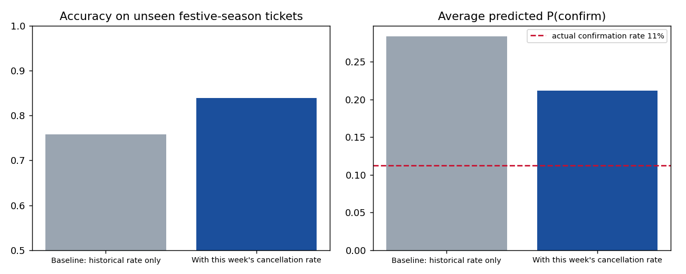
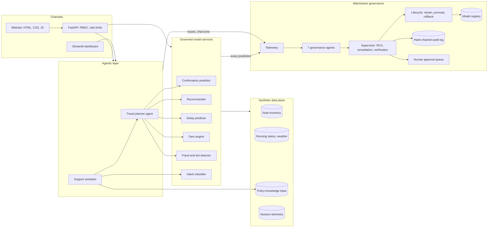
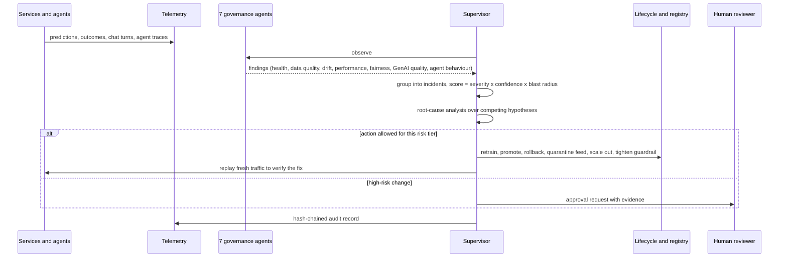

# TrainWise AI

**An AI-powered railway travel platform with an autonomous AI-governance layer.**

TrainWise runs seven passenger-facing AI services: confirmation prediction, train recommendations, delay forecasting, an agentic journey planner, fare forecasting, multilingual support and fraud/bot detection. **Watchtower** is the AI-for-AI layer on top. Its specialist agents watch every model and agent, find what is going wrong, trace the root cause, fix what policy allows, verify the fix, ask a person to approve high-risk changes, and record everything in a tamper-evident audit trail.

> **Data disclaimer.** Indian Railways' PRS (reservations) and NTES (running status) data are not publicly available, so every train, timetable, fare, passenger and incident here is **synthetic**. The generators use explicit, documented causal processes. Station codes and city names are real. Railway policy facts in the support knowledge base were checked against public sources on 15 Oct 2026, and each passage cites its source (see `data/kb/policies.json`).

## Quick start (Python 3.10+)

```bash
pip install -r requirements.txt
python scripts/run_demo.py            # about 70 s: journeys, then an 8-failure chaos drill
uvicorn trainwise.api.main:app --reload  # website at http://127.0.0.1:8000, API docs at /docs
streamlit run dashboard/app.py        # alternative operator dashboard (Streamlit)
pytest                                # 38 tests, about 3 minutes
```

The website (`web/`) is plain HTML, CSS and JavaScript with no build step, served by the API: a hero with the journey planner, one panel per passenger service, a support chat, and the Watchtower control room with signal-lamp health, failure drills, incidents, human approvals, the registry, the audit trail and the report. It is responsive down to phone widths and follows the system's light or dark theme. The demo API keys are embedded in the page because this is a prototype; a real deployment would put a login in front of it.

`docker compose up --build` runs the API on :8000 and the dashboard on :8501. A full, unedited demo transcript is in [`docs/sample_run.md`](docs/sample_run.md).

## What happens in the demo

1. **The brief's own example.** The planner parses *"Pune to Delhi tomorrow under ₹1500 and reach before 10:00 AM"*. It reads the deadline as 10:00 the next morning, since no Pune train reaches Delhi the same day, and says so. It checks seat inventory and fares, consults the confirmation and delay models and the ranking policy, rules out 15 options with stated reasons, and validates its pick independently. It then refuses to book until the passenger approves with a signed, expiring token.
2. **Every module, one by one:** confirmation odds with explanations, delay intervals with station congestion and alternatives, fare forecasts with savings, Hindi and Hinglish support replies, and bot scoring.
3. **Normal traffic, then a governance cycle.** Result: all clear.
4. **Eight real-world failures at once**, then one autonomous Watchtower cycle (abridged real output):

```
P1 delay_predictor [resolved]
   found by DriftAgent: input drift: rain_index (PSI 0.56), fog_index (PSI 0.49), upstream_delay_min (PSI 0.17)
   found by PerformanceAgent: mae 49.834 vs validated 7.661 (551% worse) and below the policy floor
   root cause (74%): Covariate shift: production inputs moved outside the training distribution ...
   action retrain: promoted v2 | verified: hold-out mae 47.8 -> 8.8; canary on 200 fresh requests: champion 45.8 vs challenger 10.2; mae 9.6 on 400 fresh 'winter_fog' requests
P1 fraud_detector [awaiting_human_approval]
   found by PerformanceAgent: recall 0.255 vs validated 1.000 (74% worse) and below the policy floor
   action retrain: challenger v2 hold-out recall 0.42 -> 0.94; canary: champion 0.25 vs challenger 0.84; promotion needs a human (high-risk service)
P2 train_recommender [resolved]
   found by FairnessAgent: premium trains get 85% of top-3 exposure vs 66% under the approved ranker
   root cause (85%): Change shipped in deployment v2 skews outcomes (by release-pipeline)
   action rollback: rolled back to v1 | verified: premium exposure shift +0.00 on 25 probe searches
P2 support_assistant [resolved]
   found by GenAIQualityAgent: 45% of replies failed the groundedness/safety check (limit 5%)
   action tighten_guardrail: applied | verified: 0/5 probe replies flagged, 0 unsafe replies served
```

5. **Human in the loop.** A reviewer approves the retrained fraud model, and the bot it previously missed is now blocked.
6. **Closed loop.** On 400 unseen festive-season tickets, accuracy rises from 0.787 (v1) to 0.845 (the autonomously retrained v2). v2 still over-predicts confirmations (21% predicted vs 11% actual): no input feature captures this season's collapse in cancellations, so a real-time cancellation-rate feed is the next fix rather than more retraining.
7. **Follow-up cycle.** It notices that delay inputs are still unusual but accuracy is fine, so it notifies the owner and does not retrain.
8. **Audit trail.** The log verifies end to end, and a copy with one edited line fails verification.

## What changed in v2

Everything below was built after the first submission and is verified by the test suite or a script in `scripts/`.

| Improvement | What it does | Evidence |
|---|---|---|
| **Conformal delay intervals** | The 80% interval is conformalised on a calibration slice (CQR), so coverage is guaranteed on exchangeable data instead of assumed. | Coverage 0.798 on the validation set at training time; `interval_coverage_80` in the registry |
| **Calibration monitoring** | Expected Calibration Error and predicted-vs-actual confirmation rates are part of every evaluation. | `ece_cnf` in the registry and in `docs/experiments.md` |
| **Fresh-feature experiment** | Shows what fixes the known festive-season over-prediction: a this-week cancellation-rate feature, not more retraining. | Festive accuracy 0.758 → 0.838, ECE 0.171 → 0.099, predicted P(confirm) 28% → 21% against 11% actual ([docs/experiments.md](docs/experiments.md)) |
| **Cost-sensitive fraud thresholds** | Challenge and block thresholds minimise expected rupee cost from `decision_costs` in the policy file, so the business owns the trade-off. | Challenge at 0.22, block at 0.95 on the bootstrap model; `scripts/run_demo.py` |
| **Canary before promotion** | A challenger must beat the champion on 200 fresh requests before it is promoted or sent for approval. | Canary lines in `docs/sample_run.md` |
| **Post-deployment burn-in baseline** | After promotion, the baseline is re-measured on the first live window, so a noisy hold-out cannot trigger a false regression alarm. | `baseline_reset` entries in the audit log |
| **Durable telemetry** | Monitoring events, outcomes and traces checkpoint to SQLite after every cycle and reload on start. | `artifacts/telemetry.sqlite`; `test_telemetry_checkpoint_roundtrip` |
| **Support evaluation harness** | 96 paraphrased questions in English, Hindi and Hinglish, with a report. | Intent accuracy 84% (English 89%, Hindi 75%, Hinglish 85%), 100% of replies pass the groundedness guard ([docs/support_eval.md](docs/support_eval.md)) |
| **Model cards** | One card per registered model: purpose, owner, risk tier, metrics, inputs, lineage, limitations. An AI inventory an auditor can read. | [docs/model_cards/](docs/model_cards/README.md) |
| **Observability stack** | Richer Prometheus metrics, Bearer-token auth for scrapers, Prometheus and Grafana in `docker-compose.yml`. | `ops/`; the compose file was written but not run here, since Docker was unavailable in my environment |



Two honest readings of the evaluation: Hindi intent accuracy (75%) is the weakest number, and the fresh feature narrows but does not close the calibration gap (21% predicted vs 11% actual). Both are listed as next steps rather than claimed as solved.

## Architecture



Every prediction goes through the same governed path (`trainwise/services.py`):

1. A **data-quality gate** blocks the request on missing values, wrong types or out-of-range inputs.
2. A **degraded-mode imputation** step fills invalid inputs with last-known-good values, but only for feeds Watchtower has quarantined.
3. The model runs **inference**.
4. **Latency and output-sanity telemetry** are recorded.
5. An **explanation** is returned on request.

Delayed ground truth (the actual chart status, actual delay, investigation outcome) is joined back to each prediction, so performance is measured live rather than assumed.

### One governance cycle



## Requirement coverage

| # | Requirement | How it is met | Code |
|---|---|---|---|
| 1 | **Ticket confirmation predictor** | Gradient-boosted classifier predicts the final chart status (CNF / RAC / WL), giving P(confirm), P(at least RAC) and confidence. A domain rule stops RAC tickets from dropping back to the waitlist. Per-prediction explanations show how far each factor moved the odds. Live accuracy is monitored and the model retrains automatically on drift. | `models/confirmation.py` |
| 2 | **Smart train recommendations** | Multi-objective score over cost, duration, availability, punctuality (from the delay model) and personal history, adjusted by preferences, with a plain-language rationale. Ranking weights are a versioned policy that can be relearned from feedback by pairwise logistic regression. Bias is checked by comparing premium-train exposure with the approved ranker on the same candidate sets. | `models/recommender.py`, `services.py` |
| 3 | **Delay and disruption prediction** | Median plus an 80% interval from quantile gradient boosting, P(on time), P(>60 min late), station congestion index, proactive alerts and better-running alternatives. Drift uses PSI and KS tests; concept change uses Page-Hinkley; retraining is automatic. | `models/delay.py`, `agents/tools.py` |
| 4 | **Agentic travel planner** | English, Hindi and Hinglish understanding. The agent searches, enriches each option with seat inventory, fares and the confirmation and delay models, optimises under constraints, and relaxes them visibly when nothing fits. An independent critic re-quotes the fare and re-checks the timetable. It books only with an HMAC-signed, expiring approval token, and fraud screening runs at booking. Full trace and audit trail. Prompt injection and passenger caps are blocked and reported to Watchtower. | `agents/travel_planner.py`, `agents/nlu.py` |
| 5 | **Dynamic fare prediction** | Machine learning forecasts *demand* (share of seats sold by day); a deterministic, flexi-style tariff converts demand to fare, so every rupee is explainable. Outputs include booking-window advice, demand-surge drivers, savings from other dates and trains, an itemised fare, and forecast-accuracy and output-anomaly monitoring. | `models/fare.py` |
| 6 | **Customer support assistant** | Intent model for English, Hindi and Hinglish. Handles PNR status (with a live confirmation forecast), refunds, cancellation and Tatkal rules from a cited knowledge base, and journey planning delegated to the agent. Escalates complaints to a person. Every reply passes a groundedness and safety guard (numbers must exist in the evidence; no credential requests). Quality, CSAT and audit records are kept for each turn. | `agents/support_assistant.py`, `governance/hallucination.py` |
| 7 | **Fraud, security and bot detection** | Supervised gradient boosting blended with an Isolation Forest trained on genuine sessions, giving a risk score, an allow / challenge / block decision, reason codes and a suspected pattern. False negatives (recall) and false positives (FPR guard) are monitored, with FPR parity checked across regions. Threat-model updates are retrained automatically but promoted only after human approval. | `models/fraud.py` |
| 8 | **Centralised AI governance (Watchtower)** | Seven agents cover the governance requirements, all thresholds live in policy-as-code YAML, and the full lifecycle (registry, champion/challenger, rollback) is automated. See the next table. | `governance/` |

| Governance capability | Implementation |
|---|---|
| Model health, SLA, resources | `HealthAgent`: p95 latency vs SLA, error rate, throughput, host CPU and memory (psutil), replica count |
| Data quality | Gate on every request, plus `DataQualityAgent` (blocked rate, offending feature and upstream pipeline) |
| Drift and degradation | `DriftAgent` (PSI, KS; calendar features exempt by design), `PerformanceAgent` (live metric vs validated baseline, Page-Hinkley change point) |
| Bias and hallucination | `FairnessAgent` (accuracy and FPR parity by segment, recommender exposure), `GenAIQualityAgent` (grounded-reply rate, escalations, CSAT) |
| Autonomous root-cause analysis | Competing hypotheses scored from evidence. Uses the dependency graph (upstream incidents, downstream blast radius) and recent deployments. Shadow-tests the previous version before blaming a deployment. |
| Lifecycle management | Retrain on the post-drift window, evaluate champion vs challenger on a hold-out with guard metrics and a fairness gate, then promote, reject or roll back with lineage |
| Explainability and transparency | Per-prediction occlusion explanations, permutation importance at training, Markdown governance reports |
| Audit and compliance | Append-only SHA-256 hash chain with PII masking (PNRs, phone and Aadhaar-like numbers, e-mails) |
| Agents monitoring agents | `AgentBehaviourAgent` watches planner traces (guardrail violations, unapproved booking attempts, loops, tool errors). The supervisor itself is capped by a per-cycle autonomous-action budget (a circuit breaker). |

## The eight failure scenarios

| Scenario | What breaks | Detected by | Root cause found | Autonomous response |
|---|---|---|---|---|
| Festival surge | Cancellations collapse; waitlists clear less than history says | PerformanceAgent | Concept drift (inputs look normal) | Retrain on post-drift data, promote, verify on fresh traffic |
| Winter fog | Inputs the delay model never saw | DriftAgent + PerformanceAgent | Covariate shift (fog, rain, upstream delay) | Retrain, promote, verify |
| Corrupted feed | Inventory feed sends null and out-of-range values | DataQualityAgent | Upstream feed fault in `prs_inventory` | Quarantine the feed, serve in degraded mode, verify |
| Novel bot attack | Human-paced bot ring hoards Tatkal seats | PerformanceAgent (recall) | Pattern absent from training data | Retrain; **human approves** promotion (high-risk tier) |
| Biased ranking update | A deployment boosts premium trains | FairnessAgent (counterfactual exposure) | The deployment itself | Roll back to the approved ranker, verify exposure |
| Hallucinating LLM | Invented refund amounts, OTP requests | GenAIQualityAgent | Ungrounded generation | Switch to grounded templates, verify with probes |
| Prompt injection | Users push the agent to book without consent | AgentBehaviourAgent | Adversarial prompts | Strict mode, notify the owner, verify a denial |
| Latency spike | p95 above SLA | HealthAgent | Capacity saturation | Scale out, verify p95 |

## Non-functional requirements: prototype vs production

| Area | In this prototype | What production would add |
|---|---|---|
| Scalability | Stateless model services, vectorised batch path, per-service replica counts | Kubernetes autoscaling, Kafka event bus, Feast feature store, read replicas. **"Millions of interactions a day" is an architectural claim here, not a load-test result.** |
| Reliability | Fallback answers when a model rejects input, degraded mode for quarantined feeds, verify-after-fix, rollback lineage | Multi-zone deployment, disaster-recovery runbooks, canary releases |
| Security | API-key RBAC (passenger / ops / admin), per-key rate limits, HMAC approval tokens, PII masking, bot detection at booking | OAuth2/OIDC, Vault for secrets, WAF, mTLS between services |
| Compliance | Policy-as-code, hash-chained audit, cited knowledge base, explanations, human approval for high-risk changes | Data-retention and consent controls designed with India's DPDP Act, 2023 in mind; external audit |
| Performance | Single-request inference in milliseconds; p95 tracked per model against a 250 ms SLA | Model compilation, caching, GPU serving for LLMs |

## Design decisions worth knowing

- **Synthetic data with explicit causal generators** (`trainwise/data/generators.py`). Each dataset documents its ground truth and has *regimes* (festival surge, winter fog, novel attack). That makes failures reproducible, which is what a governance layer needs for testing.
- **Gradient boosting plus occlusion explanations instead of SHAP.** The explanations are model-agnostic, use one batched call and add no heavy dependency. The trade-off: occlusion ignores feature interactions.
- **ML for demand, rules for money.** The fare model forecasts demand only; the tariff is deterministic and testable.
- **Deterministic language understanding first, LLM optional.** The system works offline and cannot invent a station or a fare. With `ANTHROPIC_API_KEY` set, a Claude model only fills gaps and drafts replies, and every reply still has to pass the groundedness guard.
- **Calendar features are exempt from drift alarms.** Live traffic is always "the next 60 days", so month and festival flags shift by design. Their effect is caught by performance monitoring instead.
- **Two bugs the drill exposed, both fixed.**
  - The first version retrained on a mix of old and new data. The new model's baseline was therefore inflated, and the next cycle wrongly rolled it back. Watchtower now retrains on the post-drift window only, and it shadow-tests the previous version on the same traffic before blaming a deployment.
  - Degraded-mode answers were being scored as model errors. They are now excluded from accuracy and drift.
- **Verification probes are tagged synthetic**, so they never count as real incidents.

## Limitations (stated plainly)

- Metrics are on synthetic data. For example, the fraud model's bootstrap recall of 1.0 reflects how separable synthetic attacks are, not real-world performance.
- Telemetry and the registry are in-process and file-based (stand-ins for Kafka, MLflow and a time-series database). The API and dashboard each run their own instance.
- The intent classifier is trained on about 600 template utterances. Real deployments need real chat logs.
- The tariff, capacities and congestion index are illustrative, not IRCTC's fare tables or operating data.
- Root-cause analysis is evidence-weighted hypothesis scoring, not formal causal inference.
- Fairness segments (quota, region, device) are proxies; no protected attributes are used.

## Project structure

```
trainwise-ai/
├── config/governance_policies.yaml   # every governance threshold (policy as code)
├── data/kb/policies.json             # bilingual, source-cited railway policy passages
├── trainwise/
│   ├── data/        network.py (stations, synthetic trains, tariff), inventory.py, generators.py
│   ├── models/      confirmation, delay, fare, fraud, intent, recommender, base (explanations, metrics)
│   ├── agents/      travel_planner.py, support_assistant.py, nlu.py, tools.py, llm.py
│   ├── governance/  supervisor.py (7 agents), rca.py, lifecycle.py, registry.py, monitoring.py,
│   │                drift.py, fairness.py, hallucination.py, data_quality.py, audit.py, reports.py
│   ├── api/         main.py (FastAPI), security.py (RBAC, rate limiting)
│   ├── services.py  governed serving path      simulation.py  traffic and chaos scenarios
│   └── platform.py  composition root
├── web/                              # website: index.html, styles.css, app.js (served at /)
├── dashboard/app.py                  # Streamlit: 7 passenger pages + governance console
├── scripts/run_demo.py, bootstrap.py, evaluate_support.py, experiment_fresh_feature.py, model_cards.py
├── ops/                              # Prometheus scrape config and Grafana datasource for docker-compose
├── data/eval/support_eval.json       # 96 labelled questions for the support assistant
├── tests/                            # 38 tests: models, governance, agents, API, website, dashboard, v2
└── docs/                             # sample_run.md, experiments.md, support_eval.md, model_cards/, images/
```

## API quick reference

All endpoints need an `X-API-Key` header. The demo keys are `demo-passenger-key`, `demo-ops-key` and `demo-admin-key`; override them with `TRAINWISE_API_KEYS`.

| Role | Endpoints |
|---|---|
| passenger | `GET /v1/trains`; `POST /v1/planner/plan`, `/v1/planner/book`, `/v1/confirmation/predict`, `/v1/recommendations`, `/v1/delay/predict`, `/v1/fare/forecast`, `/v1/support/chat`, `/v1/support/feedback` |
| ops | `POST /v1/fraud/score`, `/v1/governance/cycle`; `GET /v1/governance/health`, `/scenarios`, `/models`, `/approvals`, `/audit`, `/audit/verify`, `/report`, `/metrics` (Prometheus text) |
| admin | `POST /v1/governance/approvals/{id}`, `/v1/governance/simulate` |

## Configuration

| Variable | Purpose |
|---|---|
| `TRAINWISE_TODAY` | Pin "today" (YYYY-MM-DD) for reproducible demos |
| `TRAINWISE_SCALE` | `full` (default) or `small` training data |
| `TRAINWISE_ARTIFACT_DIR` | Where the registry, audit log and reports are written |
| `TRAINWISE_API_KEYS`, `TRAINWISE_RATE_LIMIT_PER_MIN`, `TRAINWISE_APPROVAL_SECRET` | API security settings |
| `ANTHROPIC_API_KEY`, `TRAINWISE_LLM_MODEL` | Optional LLM (default model `claude-haiku-5-5`; needs `pip install anthropic`) |

## Author

Prayas Sarangi. Built as a solution to the *AI-Powered Intelligent Railway Travel & Autonomous AI Governance Platform* problem statement. MIT licence.
