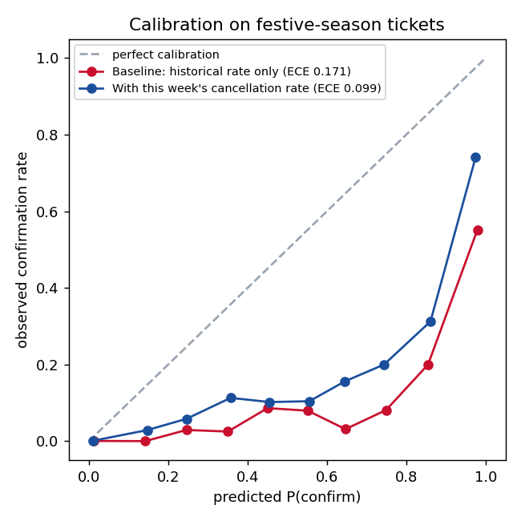

# Experiment: a fresh cancellation-rate feature

Two confirmation models trained on the same 12,000 historical tickets, evaluated on 3,000 unseen normal-season and 3,000 unseen festive-season tickets. The second model adds `recent_cancellation_rate`, the cancellation rate actually observed in the last week, which a real-time PRS feed would provide.

| Model | Accuracy (normal) | Accuracy (festive) | ECE (festive) | Mean predicted P(confirm), festive | Actual rate |
|---|---|---|---|---|---|
| Baseline: historical rate only | 0.902 | 0.758 | 0.171 | 28.4% | 11.3% |
| With this week's cancellation rate | 0.894 | 0.838 | 0.099 | 21.2% | 11.3% |

Reading: retraining alone cannot fix a shift that no input can see. A fresh feature lets the same model family track the regime change, which is a data-engineering decision rather than a modelling one. The production model keeps the original feature set so the governance drill still demonstrates concept drift; this experiment shows what the fix would be.
